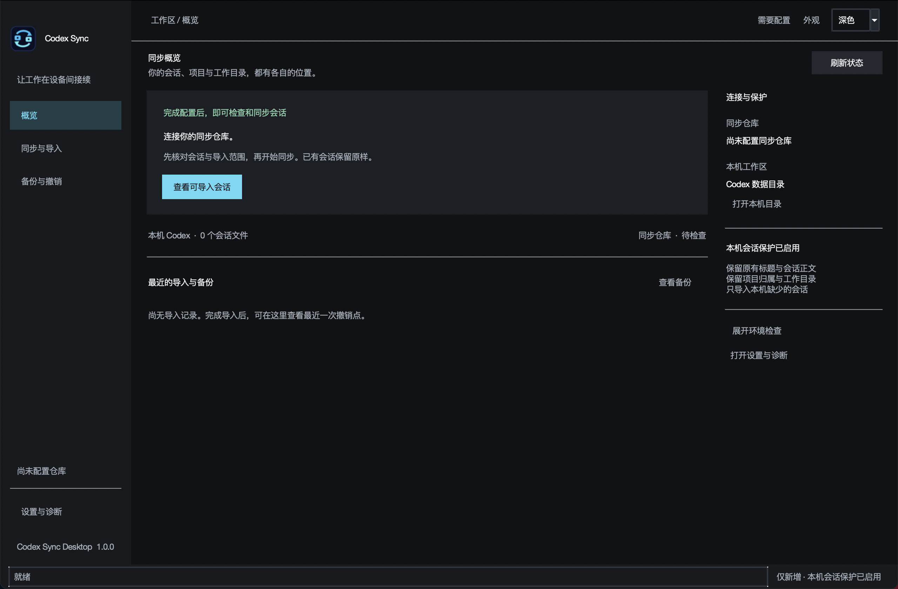
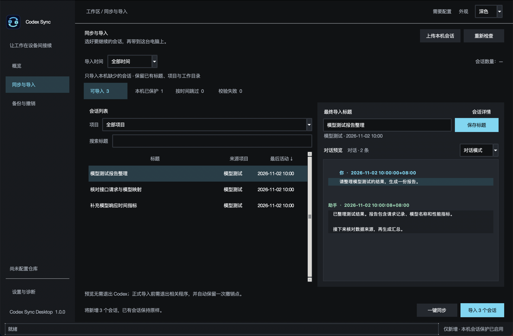
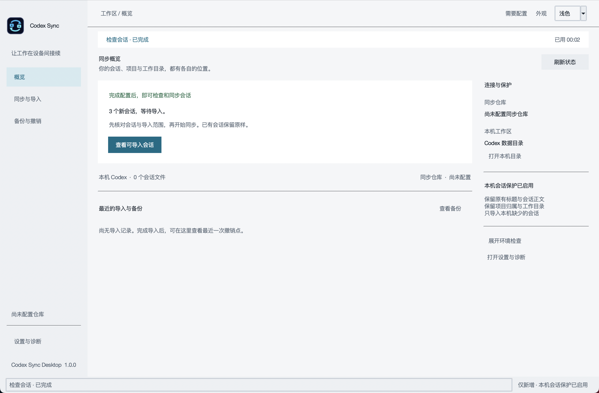
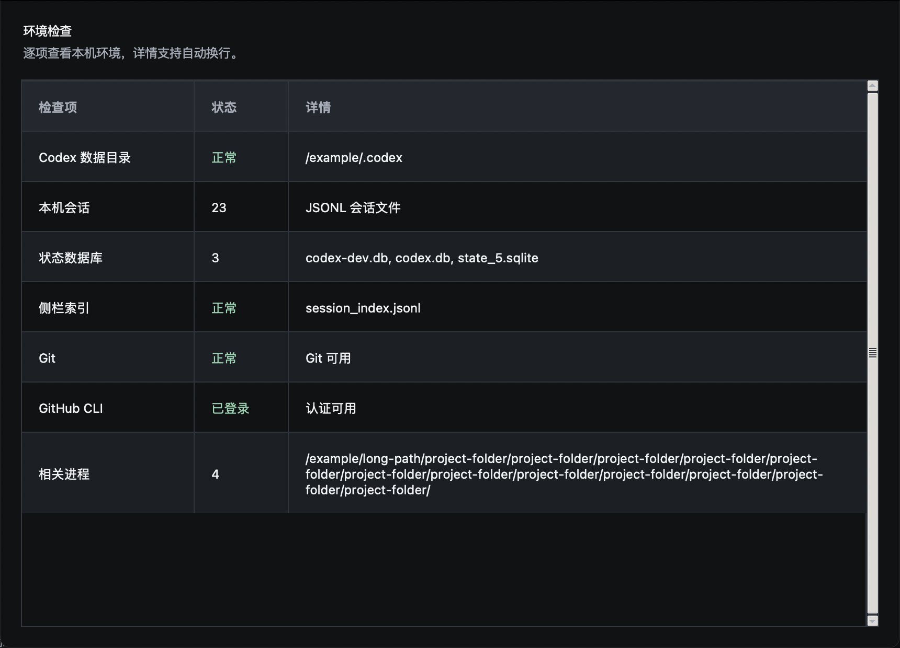
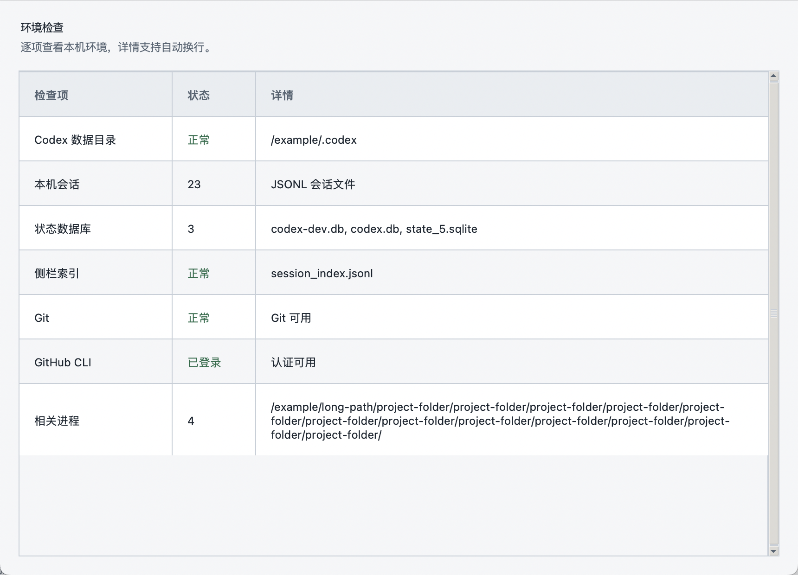
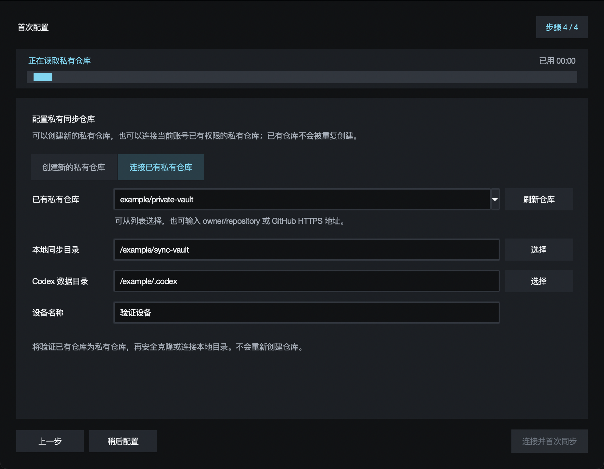
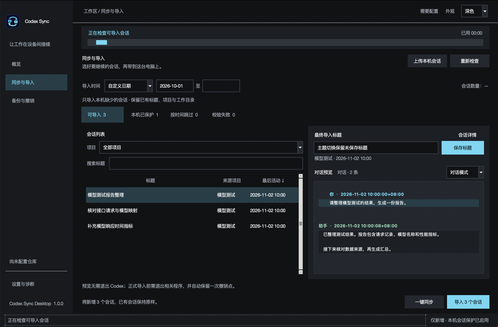

# v1.0.0 正式版

Sync Studio 界面采用深灰背景与青色强调，重新组织概览、同步与导入、备份与撤销、设置与诊断。

- 右上角“外观”可即时切换深色／浅色并保存本机偏好。
- 环境检查增加行列分隔与交替行底色，长路径自动换行。
- 任务进度移到主内容顶部，显示真实阶段与已用时间；向导仓库选择改为主题分段控件。
- 常驻会话列表与只读对话预览，支持项目筛选、标题搜索和活动时间排序。
- 支持最近活动时间和自定义日期范围；条件变化后清除旧预览。
- 导出记录来源项目，导入预览标注同项目会话。
- 完整保护本机已有会话，仅导入缺少的 ID；新增标题可预览、暂存修改。
- 保留完整记录切换、文档同步、首次配置、备份和撤销功能。

## 本机验证

Intel x86_64，macOS 13.7.8，Python 3.11 与 Tcl/Tk 8.6。197 项自动化测试通过。实际 Tk 界面验证覆盖 1280×840、1120×760、920×640，包含标题暂存、受保护标题只读、空搜索及恢复、日期条件失效、备份与设置入口；另验证深浅主题连续切换保留未保存标题、主题偏好保存、进度阶段计时与结束／失败状态、920×640 任务布局、700×500 向导布局及仓库模式切换。验证全部使用虚构数据，未向真实 Codex 目录导入。

本机安装包为 macOS Intel DMG，检查应用、向导与预览启动、文档读取、ad hoc 签名和磁盘镜像。安装包未进行 Apple 公证。本次发布已在本机验证的 macOS Intel 安装包；其他平台未在本次验证。

## 验证与截图

运行 `PYTHONPATH=. python scripts/verify_studio_ui.py`，结果保存到 `build/studio-verification`。macOS 需要可用桌面会话与 Tcl/Tk。

以下是实际程序截图，内容为虚构的验证夹具：

